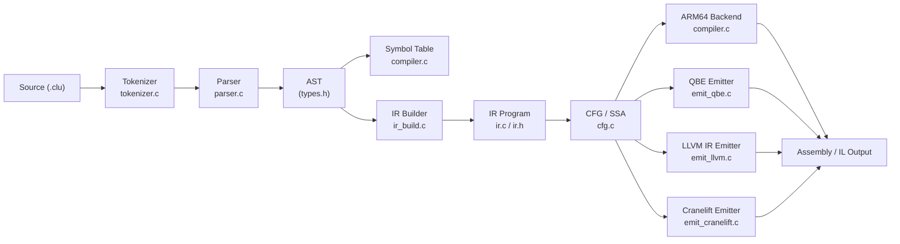

# Clumsy Codebase Analysis & Improvement Recommendations

> **Date:** November 2024  
> **Scope:** Full codebase review of the Clumsy compiler (~15,800 lines of C99)  
> **Goal:** Identify improvements for succinctness, clarity, and maintainability; evaluate Modern C++ and Rust as alternatives.

---

## Executive Summary

Clumsy is a compiler for a Lisp-style language targeting ARM64 (macOS, Apple Silicon). It features four backends (hand-rolled ARM64, QBE, LLVM IR, Cranelift CLIF), an IR → CFG → SSA pipeline, and an arena-based memory model. The codebase is well-structured at a high level, with clean separation between compilation phases. However, there is **significant code duplication** across the four emitters, **manual dynamic-array boilerplate** repeated 30+ times, **linear scans where hash maps belong**, and **global mutable state** that hinders testability. The biggest wins come from extracting shared emitter logic, adding a generic vector abstraction, and splitting oversized files—all achievable in plain C without a language change.

---

## Architecture Overview



> [!NOTE]
> The symbol table builder (`build_symbol_table()`) lives inside `compiler.c` but is shared by all backends. This is one of the key organizational issues.

---

## File-by-File Overview

| File | Lines | Responsibility |
|------|------:|----------------|
| [`types.h`](file:///Users/satish/hacking/projects/clumsy/src/types.h) | 172 | Token types, AST node types, Symbol types, SymbolTable, StructType — all in one header |
| [`arena.h`](file:///Users/satish/hacking/projects/clumsy/src/arena.h) | 32 | Arena allocator interface |
| [`arena.c`](file:///Users/satish/hacking/projects/clumsy/src/arena.c) | 77 | Arena allocator implementation |
| [`tokenizer.h`](file:///Users/satish/hacking/projects/clumsy/src/tokenizer.h) | 20 | Tokenizer interface |
| [`tokenizer.c`](file:///Users/satish/hacking/projects/clumsy/src/tokenizer.c) | 317 | Lexer |
| [`parser.h`](file:///Users/satish/hacking/projects/clumsy/src/parser.h) | 29 | Parser interface |
| [`parser.c`](file:///Users/satish/hacking/projects/clumsy/src/parser.c) | 574 | S-expression parser |
| [`ir.h`](file:///Users/satish/hacking/projects/clumsy/src/ir.h) | 274 | IR types, opcodes, operands, blocks, functions, program |
| [`ir.c`](file:///Users/satish/hacking/projects/clumsy/src/ir.c) | 564 | IR construction helpers, operand/instruction constructors, printing |
| [`ir_build.c`](file:///Users/satish/hacking/projects/clumsy/src/ir_build.c) | 1484 | AST → IR translation |
| [`cfg.c`](file:///Users/satish/hacking/projects/clumsy/src/cfg.c) | 740 | CFG building, dominator tree, SSA phi placement and renaming |
| [`cfg.h`](file:///Users/satish/hacking/projects/clumsy/src/cfg.h) | 34 | CFG/SSA pipeline interface |
| [`compiler.c`](file:///Users/satish/hacking/projects/clumsy/src/compiler.c) | 1918 | Symbol table building **+** legacy ARM64 codegen |
| [`compiler.h`](file:///Users/satish/hacking/projects/clumsy/src/compiler.h) | 65 | Legacy ARM64 codegen interface |
| [`emit_qbe.c`](file:///Users/satish/hacking/projects/clumsy/src/emit_qbe.c) | 321 | QBE IL emitter |
| [`emit_llvm.c`](file:///Users/satish/hacking/projects/clumsy/src/emit_llvm.c) | 605 | LLVM IR emitter |
| [`emit_cranelift.c`](file:///Users/satish/hacking/projects/clumsy/src/emit_cranelift.c) | 1191 | Cranelift CLIF emitter |
| [`stubs.c`](file:///Users/satish/hacking/projects/clumsy/src/stubs.c) | 89 | Variadic call stubs for Apple AArch64 |
| [`main.c`](file:///Users/satish/hacking/projects/clumsy/src/main.c) | 231 | Entry point, CLI parsing |

**Total:** ~15,800 lines across 19 files.

---

## Improvement Recommendations

### 1. Code Organization

#### 1.1 Split `types.h` into domain-specific headers

[`types.h`](file:///Users/satish/hacking/projects/clumsy/src/types.h) is a monolithic header containing tokens, AST nodes, symbols, and struct types. Split into:

- `token.h` — `TokenType`, `Token`, `TokenArray`
- `ast.h` — `ASTNodeType`, `ASTNode`
- `symbol.h` — `SymbolType`, `Symbol`, `SymbolTable`, `StructField`, `StructType`, `StructTypeTable`

This makes dependencies explicit: the tokenizer only needs `token.h`, the parser needs `token.h` + `ast.h`, etc.

#### 1.2 Extract symbol table from `compiler.c`

[`compiler.c`](file:///Users/satish/hacking/projects/clumsy/src/compiler.c) is 1918 lines doing **two unrelated things**: building the symbol table (used by all backends) and generating ARM64 assembly (used by one). The functions that should move to a new `symbol_table.c`:

- `build_symbol_table()` and all its helpers
- `find_symbol()`, `find_extern()`, `find_function()`
- `find_data_index()`, `uses_exponentiation()`
- `StructTypeTable` management functions

This would reduce `compiler.c` to ~1200 lines of pure ARM64 codegen.

#### 1.3 Rename `compiler.c` → `emit_arm64.c`

After extracting the symbol table, rename to match the naming convention of the other emitters (`emit_qbe.c`, `emit_llvm.c`, `emit_cranelift.c`). Similarly rename `compiler.h` → `emit_arm64.h`.

---

### 2. Eliminating Duplication

#### 2.1 Extract shared emitter utilities

The three IR-based emitters share near-identical code. These should be extracted into a shared `emit_common.c` / `emit_common.h`:

| Duplicated Function | Files | Description |
|---------------------|-------|-------------|
| `sanitize()` | All 3 emitters | Identical identifier sanitization |
| `find_extern()` | All 3 emitters | Linear scan for extern symbols |
| `find_function()` | All 3 emitters | Linear scan for function symbols |
| `decode_byte()` / `decode_llvm_byte()` | `emit_llvm.c`, `emit_cranelift.c` | String escape decoding (copy-pasted) |
| `find_data_index()` | All 3 emitters | Data section index lookup |
| Operand emission | All 3 emitters | Very similar patterns for formatting operands |

**Estimated savings:** ~200–300 lines of duplicated code eliminated.

#### 2.2 Deduplicate `uses_exponentiation()`

This function exists identically in both [`compiler.c`](file:///Users/satish/hacking/projects/clumsy/src/compiler.c#L407) and [`ir_build.c`](file:///Users/satish/hacking/projects/clumsy/src/ir_build.c#L1333). Move to a shared utility or into the symbol table module.

#### 2.3 Deduplicate `let` / `pub` global variable initialization

In [`ir_build.c`](file:///Users/satish/hacking/projects/clumsy/src/ir_build.c), the logic for handling `pub` global variable initialization (around line 1032) and `let`+`pub` handling (around line 1260) duplicates ~100 lines of initialization logic. Extract a shared `ir_build_global_init()` helper.

---

### 3. Data Structure Improvements

#### 3.1 Add a generic vector/dynamic-array abstraction

The same grow-by-doubling pattern with `arena_grow` is repeated **30+ times** across the codebase:

```c
if (count >= capacity) {
    capacity *= 2;
    array = arena_grow(arena, array, old_size, new_size);
}
```

Replace with a macro-based or inline generic vector:

```c
// Example macro-based approach
#define VEC_PUSH(vec, item, arena) do {          \
    if ((vec)->count >= (vec)->cap) {             \
        (vec)->cap = (vec)->cap ? (vec)->cap * 2 : 8; \
        (vec)->data = arena_grow(arena, ...);     \
    }                                             \
    (vec)->data[(vec)->count++] = (item);         \
} while(0)
```

This would eliminate hundreds of lines of boilerplate and reduce the chance of off-by-one errors in grow logic.

#### 3.2 Add hash maps for symbol/block lookups

Multiple functions perform O(n) linear scans that would benefit from hash maps:

| Function | File | Currently |
|----------|------|-----------|
| `find_block()` | `cfg.c` | Scans all blocks by label string |
| `ir_find_var()` | `ir.c` | Scans all variables by name |
| `find_symbol()` | `compiler.c` | Scans symbol table by name |
| `find_extern()` | All emitters | Scans extern list by name |
| `find_function()` | All emitters | Scans function list by name |
| `find_data_index()` | All emitters | Scans data entries by label |

A simple open-addressing hash map (or even a sorted array + binary search) would reduce these from O(n) to O(1) amortized. For a compiler, this matters as programs grow.

#### 3.3 Remove VLA (Variable-Length Array) usage

[`tokenizer.c`](file:///Users/satish/hacking/projects/clumsy/src/tokenizer.c) uses VLAs at lines 106, 172, 224, 250, 262, and 287. VLAs were made optional in C11 and are not supported by MSVC. Replace with fixed-size stack buffers or arena allocations.

#### 3.4 Remove or increase hardcoded limits

- [`ir.h`](file:///Users/satish/hacking/projects/clumsy/src/ir.h): `IRInstr.args[8]` — limits instruction arguments to 8
- [`ir.h`](file:///Users/satish/hacking/projects/clumsy/src/ir.h): `IRInstr.phi_pairs[8]` — limits phi node predecessors to 8
- [`ir_build.c`](file:///Users/satish/hacking/projects/clumsy/src/ir_build.c): `loop_stack[64]` — limits loop nesting to 64

These should use dynamic arrays (see §3.1) or at minimum be named constants with assertions on overflow.

---

### 4. Error Handling

#### 4.1 Replace `exit(1)` calls with structured error reporting

Currently, errors are handled by printing to stderr and calling `exit(1)`. This makes:
- **Testing impossible** — no way to assert that a specific input produces a specific error
- **Error recovery impossible** — the compiler can only report the first error
- **Source locations invisible** — most error messages don't include line/column numbers

Recommended approach:
```c
typedef struct {
    const char *file;
    int line, col;
    char message[256];
} CompileError;

typedef struct {
    CompileError *errors;
    int count, capacity;
} ErrorList;
```

Pass an `ErrorList *` through the pipeline. Functions return a success/failure indicator, and the caller decides whether to continue or abort.

---

### 5. API Cleanup

#### 5.1 Remove or document no-op free functions

These functions do nothing because the arena handles all deallocation:
- `free_ast()` in [`parser.c`](file:///Users/satish/hacking/projects/clumsy/src/parser.c)
- `free_token_array()` in [`tokenizer.c`](file:///Users/satish/hacking/projects/clumsy/src/tokenizer.c)
- `free_codegen()` in [`compiler.c`](file:///Users/satish/hacking/projects/clumsy/src/compiler.c)
- `free_ir_program()` in [`ir.c`](file:///Users/satish/hacking/projects/clumsy/src/ir.c)
- `ir_builder_free()` in [`ir_build.c`](file:///Users/satish/hacking/projects/clumsy/src/ir_build.c)

Options:
1. **Remove them entirely** and document that the arena owns all memory
2. **Replace with `arena_reset()`** calls so they actually free the arena's memory
3. **Keep but mark with a comment** explaining they're intentional no-ops

Option 2 is preferred — it makes the lifecycle explicit.

#### 5.2 Remove dead `AST_ADDRESS_OF` / `AST_DEREFERENCE` code paths

[`types.h`](file:///Users/satish/hacking/projects/clumsy/src/types.h) defines `AST_ADDRESS_OF` and `AST_DEREFERENCE` node types, but `&` and `*` are parsed as `AST_LIST` with identifier operators. The handling code in [`ir_build.c`](file:///Users/satish/hacking/projects/clumsy/src/ir_build.c#L549-L577) for these node types is unreachable dead code. Either:
- Remove the enum values and dead code paths, or
- Actually parse `&`/`*` into these AST types (cleaner representation)

---

### 6. Global State Reduction

The following globals hinder testability and make the code harder to reason about:

| Global | File | Recommendation |
|--------|------|----------------|
| `g_arena_compile`, `g_arena_scratch` | Multiple | Pass arenas as parameters to functions that need them |
| `static StructTypeTable *global_struct_types` | `compiler.c` | Move into a compiler context struct |
| `static bool *visited_blocks` | `cfg.c` | Allocate per-call or store in a CFG context |
| `static int cmp_counter` | `emit_qbe.c` | Store in an emitter context struct |

Introducing a `CompilerContext` struct that holds arenas, symbol tables, error lists, and configuration would make functions pure and testable:

```c
typedef struct {
    Arena *compile_arena;
    Arena *scratch_arena;
    SymbolTable *symbols;
    StructTypeTable *struct_types;
    ErrorList *errors;
    // ...
} CompilerContext;
```

---

### 7. String Dispatch Cleanup

#### 7.1 Replace `strcmp()` chains with lookup tables

Operator handling in [`ir_build.c`](file:///Users/satish/hacking/projects/clumsy/src/ir_build.c#L165-L187) and [`compiler.c`](file:///Users/satish/hacking/projects/clumsy/src/compiler.c) uses chains of `strcmp()`:

```c
if (strcmp(op, "+") == 0) { ... }
else if (strcmp(op, "-") == 0) { ... }
else if (strcmp(op, "*") == 0) { ... }
// ... 20+ more
```

Replace with a sorted lookup table + binary search, or a simple hash map:

```c
typedef struct { const char *name; IROp op; } OpEntry;
static const OpEntry op_table[] = {
    { "+", IR_ADD }, { "-", IR_SUB }, { "*", IR_MUL }, ...
};
// Binary search or perfect hash
```

This is both faster and more maintainable — adding a new operator is a one-line table entry instead of inserting into an `if-else` chain.

---

## Language Migration Assessment

### Modern C++ (C++17/20)

Moving to Modern C++ would provide **incremental benefits** without requiring a full rewrite, since C is a subset:

| C Pain Point | C++ Solution | Impact |
|-------------|-------------|--------|
| Manual dynamic arrays (30+ instances) | `std::vector<T>` | **High** — eliminates ~300 lines of boilerplate |
| Unsafe unions in AST/IR | `std::variant<Types...>` | **High** — compiler-enforced exhaustive matching |
| Linear-scan lookups | `std::unordered_map<K,V>` | **Medium** — O(1) lookups with zero effort |
| `strcmp()` chains | `switch` on `std::string_view`, or `std::unordered_map` | **Medium** — cleaner dispatch |
| No RAII for file handles | Destructors / `std::unique_ptr` | **Low** — arena already handles most memory |
| Bare enums (no namespace) | `enum class` | **Low** — prevents accidental int conversion |
| Macro-heavy generics | Templates | **Medium** — type-safe generic containers |

**Example — AST node in C++ vs C:**

```cpp
// C++ with std::variant
using ASTNode = std::variant<
    NumberLiteral,
    StringLiteral,
    Identifier,
    ListExpr,      // (op arg1 arg2 ...)
    IfExpr,
    LetBinding,
    FnDef
>;

// Pattern matching with std::visit
auto result = std::visit(overloaded{
    [](const NumberLiteral& n) { return emit_number(n); },
    [](const ListExpr& l)      { return emit_list(l); },
    // ... compiler error if a case is missing
}, node);
```

**Verdict:** C++ is a good **incremental** path. You can start by renaming `.c` → `.cpp`, switching to `std::vector`, and gradually adopting stronger types. The arena allocator can coexist with C++ containers.

---

### Rust

Rust would provide the **most dramatic improvements** but requires a full rewrite:

| C Pain Point | Rust Solution | Impact |
|-------------|--------------|--------|
| Unions / tagged types | `enum` with data fields | **Very High** — the single biggest win |
| `strcmp()` chains | `match` on enum variants | **Very High** — exhaustive, zero-cost |
| Manual dynamic arrays | `Vec<T>` | **High** — built-in, safe |
| Global mutable state | Ownership system prevents it | **High** — forced clean architecture |
| `exit(1)` error handling | `Result<T, E>` with `?` operator | **High** — composable error propagation |
| No hash maps | `HashMap<K, V>` | **Medium** — in std library |
| Null pointer bugs | `Option<T>` | **Medium** — no null pointers |
| Code duplication across emitters | Traits for backend interface | **High** — `trait Backend { fn emit_instr(...); }` |

**Example — IR operand in Rust vs C:**

```rust
// Rust enum with data — replaces the C union + tag
enum Operand {
    Temp(u32),                        // %t42
    Var { name: String, index: u32 }, // named variable
    IntLit(i64),                      // 42
    FloatLit(f64),                    // 3.14
    StringLit(String),                // "hello"
    Label(String),                    // block label
    Bool(bool),                       // true/false
}

// Exhaustive pattern matching — compiler error if you miss a variant
fn emit_operand(op: &Operand) -> String {
    match op {
        Operand::Temp(id) => format!("%t{}", id),
        Operand::Var { name, .. } => format!("%{}", name),
        Operand::IntLit(n) => n.to_string(),
        // ... compiler forces handling all cases
    }
}
```

**Example — Backend trait:**
```rust
trait Backend {
    fn emit_function(&mut self, func: &IRFunction) -> Result<(), CompileError>;
    fn emit_global(&mut self, data: &DataEntry) -> Result<(), CompileError>;
    fn emit_extern(&mut self, name: &str, params: &[Type]) -> Result<(), CompileError>;
}

struct QBEEmitter { output: String }
struct LLVMEmitter { output: String }
struct CraneliftEmitter { output: String }

impl Backend for QBEEmitter { /* ... */ }
impl Backend for LLVMEmitter { /* ... */ }
impl Backend for CraneliftEmitter { /* ... */ }
```

**Verdict:** Rust is the **best long-term choice** for this project. The compiler domain is a natural fit for Rust's enums, pattern matching, and trait system. The codebase at ~16K lines is small enough that a rewrite is feasible (estimate: 2-4 weeks of focused work, likely resulting in ~10K-12K lines of Rust).

---

## Recommended Approach

### Option A: Incremental C Cleanup (Lowest Risk)

1. Extract `emit_common.c` with shared emitter utilities (~1 day)
2. Extract `symbol_table.c` from `compiler.c` (~1 day)
3. Split `types.h` into domain headers (~0.5 day)
4. Add a `Vec` macro for dynamic arrays (~0.5 day)
5. Add a simple hash map for lookups (~1 day)
6. Remove dead code and no-op functions (~0.5 day)
7. Eliminate remaining duplication (~1 day)

**Total:** ~5-6 days. Keeps everything working, testable at each step.

### Option B: Move to C++ (Medium Risk)

Do Option A first, then:
1. Rename `.c` → `.cpp` and fix compilation (~1 day)
2. Replace manual arrays with `std::vector` (~1 day)
3. Replace lookups with `std::unordered_map` (~1 day)
4. Introduce `std::variant` for AST/IR types (~2-3 days)
5. Add `enum class` and stronger typing (~1 day)

**Total:** ~10-12 days. Gradual migration, can stop at any point.

### Option C: Rewrite in Rust (Highest Reward, Highest Risk)

Start fresh, using the existing C code as a reference:
1. Core types (tokens, AST, IR) with Rust enums (~2 days)
2. Arena → just use `Vec` and Rust ownership (~0 days — it's free)
3. Tokenizer + Parser (~2-3 days)
4. IR builder with pattern matching (~3-4 days)
5. CFG/SSA pass (~2-3 days)
6. Emitters with shared `Backend` trait (~3-4 days)
7. CLI + integration (~1 day)

**Total:** ~15-20 days. Results in a significantly cleaner, safer, more maintainable codebase.

> [!TIP]
> **My recommendation:** Start with **Option A** to understand all the moving parts and clean up the code. If you find yourself wanting stronger guarantees, jump to **Option C** (Rust). Option B (C++) is a reasonable middle ground but doesn't give you the full benefits of Rust's type system for a compiler project.

---

## Priority Matrix

| Improvement | Effort | Impact | Priority |
|------------|--------|--------|----------|
| Extract `emit_common.c` | Low | High | 🔴 Do first |
| Extract `symbol_table.c` from `compiler.c` | Low | High | 🔴 Do first |
| Generic vector macro | Low | High | 🔴 Do first |
| Split `types.h` | Low | Medium | 🟡 Do second |
| Add hash maps for lookups | Medium | Medium | 🟡 Do second |
| Deduplicate `let`/`pub` init | Low | Low | 🟢 Do when touching |
| Remove no-op free functions | Trivial | Low | 🟢 Do when touching |
| Remove dead AST node types | Trivial | Low | 🟢 Do when touching |
| Structured error handling | High | High | 🟡 Do second |
| Eliminate global state | Medium | Medium | 🟡 Do second |
| Replace `strcmp` chains | Medium | Low | 🟢 Nice to have |
| Remove VLAs | Low | Low | 🟢 Nice to have |
